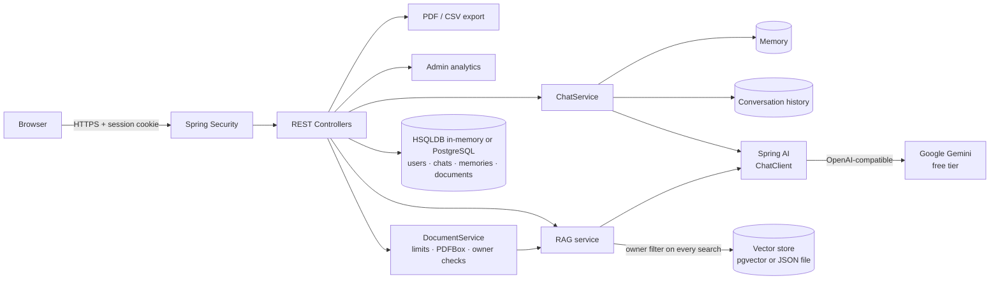

# AI Knowledge Assistant


A production-shaped AI chat application built with **Java 21**, **Spring Boot 3**, **Spring AI** and **Spring Security** — streamed responses, per-user history, persistent memory, document Q&A and admin analytics. Runs entirely on free-tier infrastructure.

**Live demo:** https://ai-knowledge-assistant-378a.onrender.com

| Account | Username | Password | Role |
|---|---|---|---|
| Demo user | `demo` | `demo123` | USER |
| Administrator | `admin` | `admin123` | ADMIN |

> Free tier sleeps after ~15 minutes. The first request can take up to a minute to wake.

---

## Why this project exists

Most "AI chatbot" portfolio projects are a text box wired to an API key. That demonstrates an API call, not engineering.

This one is built around the questions that actually matter when an LLM sits inside a real application:

- **How do you stream a response** without blocking a request thread or corrupting a JPA transaction?
- **How do you keep users apart** so one person's chats and memories never leak into another's prompt?
- **How do you stop a public endpoint** from being drained of paid quota by a script?
- **How do you know the model didn't hallucinate** when it was supposed to answer from your document?
- **What happens when the free tier goes down** or the disk resets?

Every answer is visible in the code, and the trade-offs are written down rather than hidden.

---

## Architecture



**Request path for a streamed message:**

1. `POST /api/conversations/{id}/messages/stream`
2. Rate limiter checks the caller's token bucket
3. User message persisted in its own transaction
4. Prompt assembled: system prompt + memories + last 12 messages
5. `ChatModel.stream()` piped through `SseEmitter`
6. Assistant reply persisted when the stream completes

---

## Features

| Feature | Implementation |
|---|---|
| **Streaming responses** | Server-Sent Events via `SseEmitter` + `ChatModel.stream()` |
| **Authentication** | Spring Security form login, BCrypt, session cookies |
| **Google sign-in** | OAuth2 (optional) — enabled by env vars, accounts keyed on verified email |
| **Role-based access** | `ROLE_ADMIN` enforced server-side for admin pages and APIs |
| **Conversation history** | Spring Data JDBC, per-user scoping on every query |
| **Memory** | User-authored facts injected into the system prompt, individually deletable |
| **Private document library** | Upload, list, open, delete and re-index your own PDFs; nobody else can see them |
| **Document Q&A (RAG)** | PDF → page-by-page text → chunks → embeddings → owner-filtered similarity search |
| **Citations** | Answers cite file and page, e.g. `[1] handbook.pdf, page 3`; chat shows source chips |
| **Hallucination guard** | Token-overlap score between answer and retrieved context |
| **Vector persistence** | Store saved to disk, reloaded on boot without re-embedding |
| **Structured JSON output** | `ChatClient.entity()` with a typed record |
| **Function calling** | `@Tool` methods bound to the signed-in user per request |
| **Guest trial** | 5 messages without an account, then a sign-up prompt |
| **Rate limiting** | Bucket4j token bucket, 20 req/min per user or IP |
| **BYOK** | Users can bring their own API key — AES-GCM encrypted, write-only, masked |
| **Input sanitisation** | Control characters stripped, hard length caps |
| **Global error handling** | One JSON error shape with a request id; no internals leak |
| **Structured logs** | Log4j2 JSON (ECS) with the request id on every line; no personal data or document text |
| **Markdown + code highlighting** | `marked` + DOMPurify + highlight.js |
| **Voice** | Web Speech API for input and text-to-speech output |
| **Export** | Conversation to CSV (formula-safe) or PDF (Apache PDFBox) |
| **Health check** | `/actuator/health/liveness` — no database work, for Render's probe |
| **API documentation** | Swagger UI at `/swagger-ui.html` |
| **CI** | GitHub Actions: build, tests, PMD lint, banned-dependency and licence gates, Trivy scan, zero-config container start |

---

## Quick start

It works out of the box: no database, no Google login and no AI key are needed to start.

```bash
git clone https://github.com/2307shukla/ai-knowledge-assistant.git
cd ai-knowledge-assistant
./mvnw spring-boot:run          # Windows: mvnw.cmd spring-boot:run
```

Open http://localhost:8080 and sign in with `demo` / `demo123`.

To get answers, add a free Gemini key (no credit card, https://aistudio.google.com/apikey) in one of two ways:

- **In the app:** sidebar → *Your API key* → paste → Save (each user can use their own key), or
- **For everyone:** `export AI_API_KEY=your-key` before starting (Windows: `set AI_API_KEY=your-key`).

### Or with Docker (one command)

```bash
docker compose up --build                          # http://localhost:8080, built-in database
docker compose --profile postgres up --build       # also http://localhost:8081 on local PostgreSQL + pgvector
```

Optional settings go in a `.env` file: copy `.env.example`, which lists every variable. Never commit `.env`.

---

## Environment variables

All optional. The app starts with none of them.

| Variable | Default | Purpose |
|---|---|---|
| `AI_API_KEY` | unset | Shared Gemini key. Without it, users add their own key in the app. |
| `DATABASE_URL` | built-in HSQLDB (in memory) | PostgreSQL with pgvector, pasted as the provider shows it. Enables persistence. |
| `APP_ENCRYPTION_KEY` | random per start | Base64 of 32 bytes; encrypts saved user keys. Set it, or saved keys are lost on restart. |
| `GOOGLE_CLIENT_ID`, `GOOGLE_CLIENT_SECRET` | unset | Google sign-in. Without them only password login and guest mode appear. |
| `DOCUMENTS_MAX_BYTES` | `5242880` (5 MB) | Largest PDF accepted. |
| `DOCUMENTS_MAX_PAGES` | `50` | Most pages per PDF. |
| `DOCUMENTS_MAX_PER_USER` | `20` | Documents each user may keep. |
| `DOCUMENTS_MAX_CHUNKS` | `400` | Most passages per document (bounds embedding calls). |
| `VECTOR_STORE_PATH` | `./data/vector-store.json` | File used for embeddings when there is no PostgreSQL. |

## Configuration

Everything except the key is committed:

```properties
spring.ai.openai.base-url=https://generativelanguage.googleapis.com/v1beta/openai
spring.ai.openai.api-key=${AI_API_KEY:unset}
spring.ai.openai.chat.completions-path=/chat/completions
spring.ai.openai.embedding.embeddings-path=/embeddings
spring.ai.openai.chat.options.model=gemini-3.6-flash
spring.ai.openai.embedding.options.model=gemini-embedding-001
app.vector-store.path=${VECTOR_STORE_PATH:./data/vector-store.json}
```

> Gemini is reached through its **OpenAI-compatible** surface, so the standard Spring AI OpenAI client is used unchanged — note there is **no `/v1`** in its paths.

**Provider-agnostic by design.** Any OpenAI-compatible endpoint works, including a local Ollama:

```bash
java -jar app.jar \
  --spring.ai.openai.base-url=http://localhost:11434/v1 \
  --spring.ai.openai.api-key=ollama \
  --spring.ai.openai.chat.options.model=llama3.2 \
  --spring.ai.openai.embedding.options.model=nomic-embed-text
```

---

## Sign-in options

| Method | Notes |
|---|---|
| Username + password | Seeded `demo` / `admin`, plus self-registration |
| **Continue with Google** | Appears automatically when OAuth credentials are configured |

Enable Google sign-in with two environment variables:

```
GOOGLE_CLIENT_ID     = <client id>.apps.googleusercontent.com
GOOGLE_CLIENT_SECRET = <client secret>
```

Authorised redirect URI in Google Cloud Console:

```
https://<your-host>/login/oauth2/code/google
```

Design notes worth knowing:

- The registration is built **in code**, not mapped from properties, so a missing or malformed configuration hides the button instead of breaking startup.
- The principal name is the **verified email**, which is also `User.username` — so signing in with Google on an existing password account keeps its conversations and memories.
- `server.forward-headers-strategy=framework` is required behind Render's TLS-terminating proxy, otherwise the generated `redirect_uri` is `http://` and Google returns `redirect_uri_mismatch`.

---

## API

Interactive docs: **https://ai-knowledge-assistant-378a.onrender.com/swagger-ui.html**

| Method | Endpoint | Description |
|---|---|---|
| `POST` | `/api/auth/register` | Create an account |
| `GET` | `/api/auth/me` | Current user |
| `GET` | `/api/conversations` | List conversations |
| `POST` | `/api/conversations` | Create a conversation |
| `DELETE` | `/api/conversations/{id}` | Delete a conversation |
| `GET` | `/api/conversations/{id}/messages` | Message history |
| `POST` | `/api/conversations/{id}/messages` | Send (non-streaming) |
| `POST` | `/api/conversations/{id}/messages/stream` | Send, streamed via SSE |
| `GET` | `/api/conversations/{id}/export.csv` | Export conversation as CSV |
| `GET` | `/api/conversations/{id}/export.pdf` | Export conversation as PDF |
| `GET` / `POST` / `DELETE` | `/api/memories` | Manage memory |
| `GET` / `POST` / `DELETE` | `/api/keys` | BYOK: manage your own provider key |
| `POST` | `/api/rag/upload` | Upload a PDF to your private library |
| `GET` | `/api/rag/documents` | Your documents and the public sample, with limits |
| `GET` | `/api/rag/documents/{id}` | One document (404 if it is not yours) |
| `DELETE` | `/api/rag/documents/{id}` | Delete your document and its embeddings |
| `POST` | `/api/rag/documents/{id}/reindex` | Re-embed your document from its stored text |
| `GET` | `/api/rag/ask` | Answer from your documents, with page citations and grounding score |
| `POST` | `/api/insights` | Structured JSON answer |
| `POST` | `/api/tools/ask` | Function calling |
| `POST` | `/api/guest/chat` | Anonymous trial (5 messages) |
| `GET` | `/api/admin/stats` | Aggregate analytics (ADMIN only) |
| `GET` | `/actuator/health/liveness` | Liveness probe (no database work) |

Unauthenticated API calls return **401 JSON**; browser navigations redirect to the login page.

To answer a chat message from your documents, send `{"content": "...", "useDocuments": true}`; the reply includes `sources` (file, page, snippet) and the streamed endpoint sends them as its first event.

Every error has one shape, and the request id matches the server log line:

```json
{ "status": 413, "error": "The PDF has 80 pages. The limit is 50.", "requestId": "4f0c…" }
```

---

## Document library and privacy

- **Private by default.** Each document belongs to the user who uploaded it. Search, chat, list, get, delete and re-index all check the owner. Another user's document id answers **404**, exactly like an id that does not exist, so ids cannot be probed.
- **Two layers.** The database lookup is scoped to the owner, and every vector carries an `owner` field that each similarity search filters on (`owner IN (me, public)`). Results are checked again before use.
- **Public sample.** The bundled sample document is readable by everyone and cannot be changed or deleted by anyone.
- **Legacy vectors are quarantined.** Embeddings created before this version have no owner. The filter excludes them from every search and no API lists them. The start-up log reports how many there are (a count only).
- **Upload rules.** PDF only, verified by its `%PDF-` signature, not the file name. Size, page and per-user limits are checked before any text is extracted; encrypted or damaged PDFs are refused with a clear message. Pages are read one at a time to stay well inside 512 MB.

### Hallucination guard

```json
{ "answer": "...", "grounded": true, "overlap": 0.89 }
```

A token-overlap heuristic flags answers whose vocabulary does not appear in the retrieved context. It catches the common failure — the model answering from its weights instead of the document — and **does not** catch a fluent answer that reuses the document's words while distorting meaning. It is a cheap signal, not a proof.

---

## Admin analytics

Sign in as `admin` and open `/admin.html`.

Shows aggregate counts only — users, conversations, messages, memories, average messages per conversation, and a per-user table. **No message content is exposed**, and access is enforced by Spring Security, not by hiding a link.

---

## Bring your own key (BYOK)

Users can store their own provider key. Their requests are then made with that key, so usage is billed to them and never touches the shared quota.

| Endpoint | Purpose |
|---|---|
| `GET /api/keys` | `{configured, hint, encryptionPersistent}` — never the key |
| `POST /api/keys` | Store a key (write-only) |
| `DELETE /api/keys` | Remove it |

Security decisions, and why:

- **Encrypted at rest** with AES-GCM. GCM authenticates the ciphertext, so a tampered value fails to decrypt instead of producing garbage.
- **Write-only API.** There is no endpoint that returns the key — not even to its owner.
- **Masked hint only.** The UI shows `****1234`.
- **Never logged**, including in error paths.
- **Per-request model.** A user with a key gets their own `OpenAiChatModel`; everyone else transparently falls back to the shared key.

Set the encryption key in production:

```bash
openssl rand -base64 32        # copy into APP_ENCRYPTION_KEY on Render
```

If `APP_ENCRYPTION_KEY` is unset, a per-process key is generated and stored keys are lost on restart — the application logs a warning rather than failing silently.

**Scope limitation:** BYOK covers chat only. Document embeddings still use the server key, because the vector store is shared across users and mixing providers there would produce incomparable vectors.

---

## Performance

Load-tested with 300 requests at concurrency 20 and 500 at concurrency 50:

| Concurrency | Throughput | p50 | p95 | Errors |
|---|---|---|---|---|
| 20 | 144.7 req/s | 117.7 ms | 266.1 ms | **0** |
| 50 | 127.4 req/s | 306.4 ms | 1,115.8 ms | **0** |

Throughput plateaus around 130 req/s while p95 rises ~4× — the saturation point of a single instance. Full method and raw numbers: [`loadtest/RESULTS.md`](loadtest/RESULTS.md).

---

## Persistence

| Data | Default (HSQLDB) | With `DATABASE_URL` → Postgres |
|---|---|---|
| Users, conversations, memories, document list | HSQLDB in-memory — ❌ recreated on boot (document list rebuilt from the vector file) | ✅ persistent |
| Document embeddings | JSON file (`data/vector-store.json`) — ✅ reloaded, not re-embedded | ✅ `PgVectorStore` (`vector_store` table) |

Embeddings are the expensive part — each chunk costs an API call. In file mode the store is written after every index operation and reloaded on startup.

> **Caveat:** Render's free tier has an ephemeral filesystem. The JSON file survives a restart of a running instance but **not** a redeploy or sleep/wake.

### Switching to Postgres (free)

Any free-tier Postgres with the `pgvector` extension works, for example Neon, Supabase, or Render's free Postgres (which expires after 30 days). Copy the provider's connection string as-is into one variable:

```
DATABASE_URL=postgresql://<user>:<password>@<host>/<db>?sslmode=require
```

At startup `DatabaseUrlEnvironmentPostProcessor` converts it into JDBC settings, and it takes precedence over any `SPRING_DATASOURCE_*` variables. A `jdbc:postgresql://…` URL is accepted too.

A Postgres database is detected at startup and embeddings switch to `PgVectorStore` automatically. The app runs `CREATE EXTENSION IF NOT EXISTS vector` and creates the table on first boot; if your database user can't create extensions, enable `vector` once from the provider's dashboard.

---

## Project structure

```
src/main/java/com/abhijeet/ai_knowledge_assistant/
├── config/        ChatClient, OpenAPI, demo data
├── controller/    chat, auth, memory, RAG, admin, export, tools
├── domain/        User, Conversation, ChatMessage, Memory, KnowledgeDocument, DocumentChunk
├── exception/     error JSON shape and user-safe messages
├── export/        PDFBox writer for conversation export
├── rag/           chunking, citations, prompt rules
├── repository/    Spring Data JDBC interfaces (schema in schema.sql)
├── security/      SecurityConfig, UserDetailsService, rate limiter, request ids
├── service/       ChatService, ChatPersistence, DocumentService, RagService
├── tools/         @Tool methods for function calling
└── util/          InputSanitizer, GroundingCheck
```

---

## Screenshots & demo

Add your own captures — the README renders them once the files exist:

```markdown


```

To capture: open the live URL, press **Win + G** (Windows Game Bar) to record a short clip, and save screenshots with **Win + Shift + S** into a `docs/` folder.

---

## Known limitations

- **HSQLDB is in-memory by default.** Accounts and chats reset when the container restarts unless `DATABASE_URL` points at Postgres (see [Persistence](#persistence)).
- **CSRF tokens are disabled** for the JSON single-page UI. The session cookie is `SameSite=Lax`, so browsers don't send it on cross-site POST/PUT/DELETE requests, which blocks classic CSRF. Production would add `CookieCsrfTokenRepository` with an `X-XSRF-TOKEN` header as well.
- **Rate limiting is per-instance.** Buckets live in memory; multiple instances would need Redis.
- **Prompt injection is not solved.** The system prompt is server-controlled and the model has no tools that act on untrusted input, but no filter reliably prevents injection.
- **Structured output is model-dependent.** Small models fail the schema; the endpoint returns 502 rather than nulls when that happens.
- **Demo accounts are public** by design, so do not store anything private in them.
- **Scanned PDFs are not supported.** There is no OCR; image-only PDFs are refused with a message.

---

## Security notes

- Authentication and authorisation on every endpoint; documents and conversations are always loaded with the caller as owner.
- SQL only through Spring Data derived queries or bound parameters; no string-built SQL with user input.
- Input limits: question length, message length, upload size, pages, document count, rate limit (20 requests/minute per user or IP covers chat, ask, upload and re-index).
- File names are reduced to a display name (no paths, control or markup characters) and are never used as file paths.
- Errors return a short message and a request id. Stack traces, exception names, SQL and provider responses stay in the server log.
- Logs are JSON with the request id. They contain ids and counts only: no document text, prompts, API keys, e-mail addresses or usernames.
- No secrets in the repository. Every secret is an environment variable (see `.env.example`). User API keys are AES-GCM encrypted.
- The container runs as a non-root user.
- Dependencies are scanned with Trivy in CI and the build fails on fixable HIGH or CRITICAL issues. Three Spring Framework issues that are fixed only in Spring Boot 4 are listed in `.trivyignore` with a reason and an expiry date (2027-01-31); the move to Spring Boot 4 is planned for Phase 2.

To delete legacy ownerless embeddings after checking the count (PostgreSQL):

```sql
SELECT COUNT(*) FROM vector_store WHERE metadata->>'owner' IS NULL;  -- check first
DELETE FROM vector_store WHERE metadata->>'owner' IS NULL;           -- then, if you are sure
```

---

## Licences

Runtime dependencies are MIT, Apache-2.0 or BSD only, plus the Jakarta APIs (EPL-2.0, approved exception). CI enforces this: the build fails if Logback, Hibernate, H2, OpenPDF or AspectJ return, and a licence gate checks the CycloneDX SBOM (uploaded with each CI run) and fails on any licence that is not approved. LatencyUtils (CC0) is excluded from Micrometer for this reason. The Docker image uses Eclipse Temurin (GPL-2.0 with the Classpath Exception, approved). Test-only: JUnit 5 (EPL-2.0, approved).

---

## Deploying on Render (free tier)

1. Set **Health Check Path** to `/actuator/health/liveness` (Settings → Health & Alerts).
2. Set `AI_API_KEY`, `APP_ENCRYPTION_KEY` and, for persistence, `DATABASE_URL`.
3. Design decisions are recorded in [`docs/adr`](docs/adr).

---

## Related project

**[AI Log Analyzer](https://github.com/2307shukla/ai-log-analyzer)**: Spring Boot + Spring AI security and reliability log analyzer. It detects nine log formats, runs deterministic detection rules with MITRE ATT&CK mapping, scores suspicious IPs with offline GeoIP, fires YAML alert rules, charts errors and spikes, exports PDF reports, and uses an LLM only for the incident report and chat. Live: https://ai-log-analyzer-5l3n.onrender.com

---

## Licence

MIT
